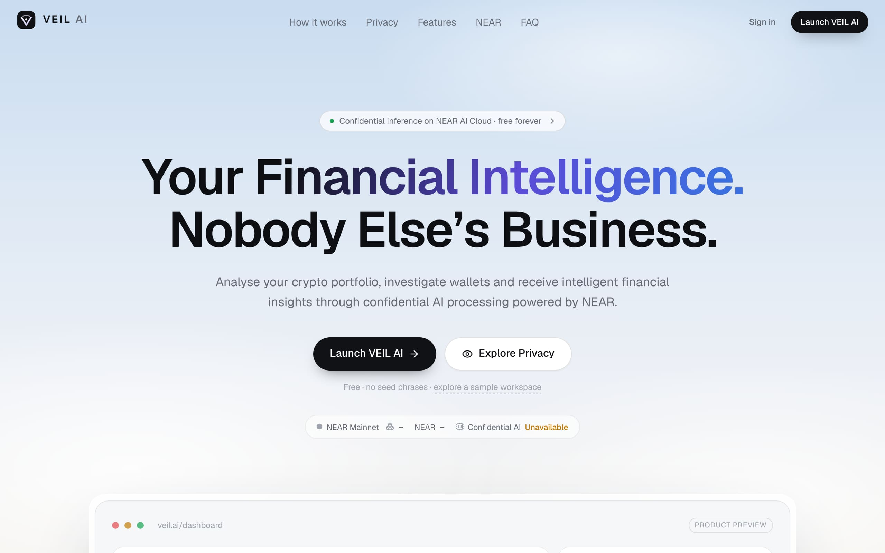
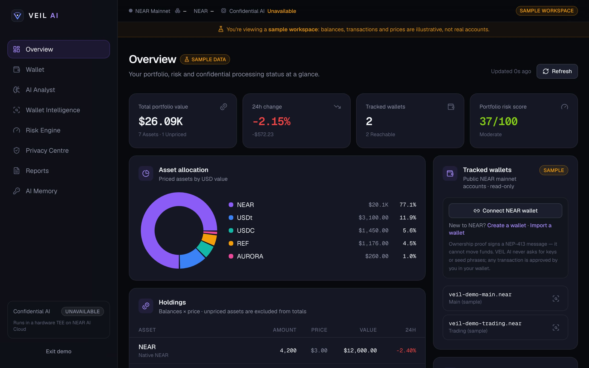
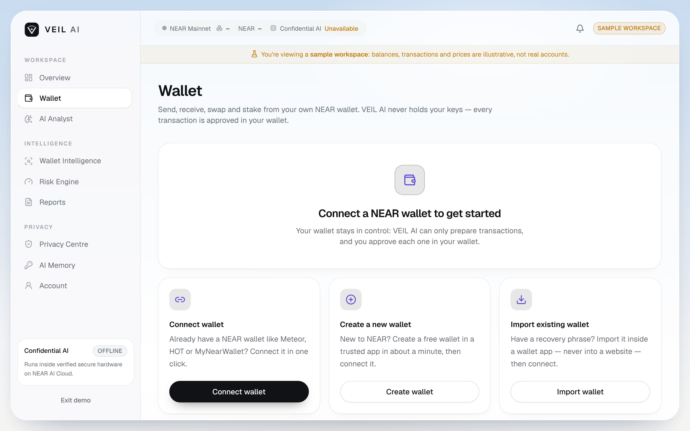
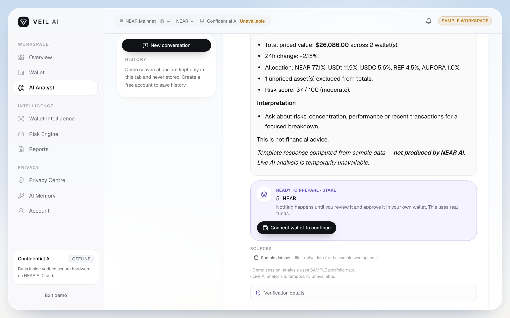
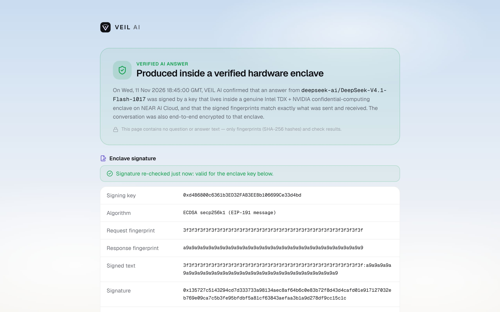

# VEIL AI

**Confidential financial intelligence, powered by NEAR.**
*Your financial intelligence. Your private data. Verified by NEAR.*

VEIL AI analyses NEAR crypto portfolios, investigates public wallets, scores portfolio risk with transparent formulas, and answers financial questions using an LLM that runs inside a hardware Trusted Execution Environment on **NEAR AI Cloud**. Every answer is checked: the response signature, request/response hashes and a fresh-nonce TEE attestation (Intel TDX + NVIDIA GPU) are verified before VEIL AI shows **VERIFIED**.

Built for the **NEAR Hackathon 2026 — Privacy & Private AI track**. Free for everyone, with no subscriptions, paid tiers or paywalls.

---

| | |
|---|---|
|  |  |
|  |  |



*Screenshots taken with example data; the live app only ever shows real data from your own account.*

## Features

| Page | What it does |
|---|---|
| `/` | Landing page: product, how it works, privacy model, features, NEAR integration, verification, FAQ |
| `/dashboard` | Portfolio value, 24h change, allocation, holdings, tracked wallets, risk score, recent transactions, on-demand AI insights, privacy status |
| `/dashboard/wallet` | Connect, create or import a NEAR wallet; send, receive (QR), swap via NEAR Intents, stake/unstake/withdraw with validators; activity history; address book. Sends get a **receiver safety check** (look-alike/address-poisoning, new or empty accounts, token/contract receivers, risk lists, wallet-intelligence heuristics). Every transaction is reviewed in-app and approved in the user's wallet |
| `/dashboard/analyst` | Streaming AI analyst on NEAR AI Cloud, with conversation history (save/delete), sources, and per-answer verification details. Ask "stake 5 NEAR with the lowest-fee validator" or "send 2 NEAR to bob.near" and an action card prepares it for review and wallet approval. Verified answers get a **shareable proof link** |
| `/dashboard/account` | Your `name.near` account (create it if you skipped it at sign-up), sign-in email and notification settings |
| `/proof/[token]` | Public, content-free proof that an answer was signed inside a verified enclave: the enclave signature is re-checked on load, and anyone can request a fresh attestation |
| `/dashboard/wallet-intelligence` | Investigate any public NEAR account: overview, timeline, stats, counterparties, contract calls, large transfers, evidence-based indicators, AI explanation (labelled as interpretation) |
| `/dashboard/risk-engine` | Seven risk categories (concentration/HHI, volatility, liquidity, exposure, performance/drawdown, activity, suspicious) with every input shown |
| `/dashboard/privacy` | NEAR AI connection, live attestation verification with fresh nonces, every check with expected/actual values, model info, processing history, data-handling matrix |
| `/dashboard/reports` | Portfolio, risk, wallet and AI-summary reports with sources and methodology; PDF rendered in the browser |
| `/dashboard/memory` | Opt-in financial preferences the AI may use: inspect, edit, delete |

Wallets connect through **NEAR Connect**. Ownership is proven with a **NEP-413** signed message, which cannot move funds. VEIL AI never asks for seed phrases or keys and never moves funds on its own.

The **Wallet** page (`/dashboard/wallet`) lets users connect a wallet, or create/import one in a trusted wallet app (guided — keys never touch VEIL AI), then **send, receive, swap (NEAR Intents) and stake**. Every transaction is prepared and checked server-side, shown in a plain-language review, and signed only by the user's own wallet.

**Sign-up** takes an email, a password and the `name.near` you want. A 6-digit **code is emailed** and typed into the app (no link to click); then the user creates their real **`name.near`** account right there — the browser generates the key and 12-word recovery phrase, and VEIL only stores the account name. To use it in a wallet, people import the 12 words into a web wallet such as MyNearWallet (nothing to install) and connect it. A **notification bell** shows money received, swap results, unstaked NEAR ready to withdraw and transactions sent — with optional browser alerts while VEIL AI is open (stored only in that browser).

VEIL AI is installable as an app (web app manifest) and runs on NEAR **testnet** by setting `NEXT_PUBLIC_NEAR_NETWORK=testnet` — useful as a risk-free judging deployment (swaps are mainnet-only, because NEAR Intents doesn't run on testnet).

## Documentation

- [docs/NEAR-INTEGRATION.md](docs/NEAR-INTEGRATION.md): exactly how NEAR powers the product, endpoint by endpoint
- [docs/PRIVACY.md](docs/PRIVACY.md): privacy architecture, and what is and is not protected
- [docs/SECURITY.md](docs/SECURITY.md): threat model and controls
- [docs/ARCHITECTURE.md](docs/ARCHITECTURE.md): structure, modes, pipeline, data model
- [docs/SUBMISSION.md](docs/SUBMISSION.md): hackathon write-up and demo video script

## Quick start

Requires Node.js ≥ 20.9.

```bash
npm install
```

```bash
cp .env.example .env.local
```

```bash
npm run dev
```

Open http://localhost:3000. Sign-in needs Supabase configured (see below). Without a NEAR AI key the analyst gives rule-based answers labelled "AI offline", and attestation shows NOT CONNECTED / UNVERIFIED.

### Enable live NEAR AI confidential inference

1. Create an API key at [cloud.near.ai](https://cloud.near.ai).
2. Set `NEAR_AI_API_KEY` in `.env.local`. Optionally set `NEAR_AI_MODEL` to any model from `GET https://cloud-api.near.ai/v1/models`.
3. Restart, then open **Privacy Centre → Verify attestation now**.

### Enable accounts and persistence (Supabase)

1. Create a project at [supabase.com](https://supabase.com).
2. Run the migrations in order: paste `supabase/migrations/20261104000000_init.sql`, then `supabase/migrations/20261111000000_contacts.sql` (address book), then `supabase/migrations/20261113000000_sponsored_accounts.sql` (free name.near accounts) into the SQL editor, or use `supabase db push`.
3. Set `NEXT_PUBLIC_SUPABASE_URL` and `NEXT_PUBLIC_SUPABASE_ANON_KEY`.
4. Auth → URL configuration: add `http://localhost:3000/auth/callback` (and your production URL) as redirect URLs.
5. Optional: enable the Google provider, then set `NEXT_PUBLIC_GOOGLE_AUTH_ENABLED=true`.
6. Set `DATA_ENCRYPTION_KEY` (from `openssl rand -hex 32`) to encrypt stored messages, goals and reports, and `APP_SECRET` for signed NEP-413 challenges and shareable proof links (keep it stable — changing it invalidates existing proof links).

**Email codes instead of links:** in Supabase → Authentication → Emails → *Confirm signup*, put the code in the template, e.g. `<h2>Your VEIL AI code</h2><p>Enter this code to verify your email:</p><h1>{{ .Token }}</h1>`. The app verifies it with `verifyOtp`. (Old link-style emails still work through `/auth/callback`.)

To let new users **create their own `name.near` account for free**, create a dedicated NEAR account for VEIL (e.g. `veil-sponsor.near`), put a little NEAR in it (each new account costs `NEAR_SPONSOR_DEPOSIT_NEAR`, default 0.01 NEAR), and set `NEAR_SPONSOR_ACCOUNT_ID` and `NEAR_SPONSOR_PRIVATE_KEY` (plus `SUPABASE_SERVICE_ROLE_KEY`). Users' keys and recovery phrases are generated in their browser and never reach the server; the database stores only the account name. One account per VEIL user, with a daily cap (`NEAR_SPONSOR_DAILY_LIMIT`). On testnet, fund the sponsor from the faucet.

To enable swaps, request a NEAR Intents 1Click API key (JWT) from the NEAR Intents team and set `ONECLICK_JWT` (server-side only). Without it, the Swap tab shows that swaps are unavailable.

Optional keys (`NEARBLOCKS_API_KEY`, `COINGECKO_API_KEY`, `FASTNEAR_API_KEY`) raise third-party rate limits. All variables are documented in [.env.example](.env.example). Missing configuration is reported clearly at server startup.

## Scripts

```bash
npm run typecheck   # next typegen + tsc --noEmit
```

```bash
npm run lint        # ESLint (next/core-web-vitals + typescript)
```

```bash
npm test            # Vitest unit + integration tests
```

```bash
npm run build       # production build
```

```bash
npm run check       # all of the above
```

The tests cover account validation and secret detection, portfolio maths, risk scoring, wallet heuristics, NearBlocks normalisation, prompt-injection sanitisation, data minimisation, rate limiting, AES-GCM and signed tokens, TDX report-data and compose binding, ECDSA/Ed25519 completion signatures, E2EE v2 round-trips, NEP-413, and the verification orchestrator. The orchestrator tests check that VERIFIED only appears when every check passes. Route-level tests cover access control, CSRF, validation, rate limiting and the analyst stream without a NEAR AI key.

## Testnet deployment (for judges)

Create a second Vercel project from the same repository with `NEXT_PUBLIC_NEAR_NETWORK=testnet` (plus the same NEAR AI and Supabase variables). Wallets connect on testnet, the Wallet page shows a faucet link (near-faucet.io), and send/stake work with free test NEAR.

## Deploying to Vercel

1. Push the repository to GitHub and import it in Vercel. The framework preset is Next.js and needs no build settings.
2. Add the environment variables from `.env.example` under Project → Settings → Environment Variables. At minimum, set `NEAR_AI_API_KEY`, the Supabase URL and anon key, `DATA_ENCRYPTION_KEY`, `APP_SECRET` and `NEXT_PUBLIC_APP_URL`.
3. Add `https://<your-domain>/auth/callback` to Supabase's redirect URLs.
4. Deploy. API routes run on the Node.js runtime. The Intel TDX verifier `@phala/dcap-qvl` (pure JS) is kept as an external Node dependency (`next.config.ts`).
5. The chat route uses streaming responses with `maxDuration = 120`. If your Vercel plan caps duration lower, reduce `NEAR_AI_MAX_TOKENS`.

## Costs and fees

VEIL AI charges users nothing. The deployer pays for NEAR AI Cloud inference on their own NEAR AI account. Public data APIs may rate-limit anonymous traffic. VEIL AI charges no fee on transactions. If a user sends, swaps or stakes, their wallet pays standard NEAR gas (typically under 0.001 NEAR), and swaps include the NEAR Intents route fee shown in the quote before approval.

## Limitations

- Supported chain: **NEAR** (mainnet or testnet) only.
- History-based analysis uses recent samples (the latest 50 transactions and 50 token transfers), not complete history.
- VEIL AI's own server is not a TEE; see [docs/PRIVACY.md](docs/PRIVACY.md).
- In-memory rate limits apply per server instance.

## Disclaimer

Informational analysis only. This is not financial, investment, tax or legal advice. Crypto assets are volatile.
